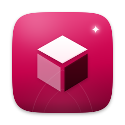

# Vigil Render

**A product of VigilTech, vigiltech.org.** VigilTech was founded by **Demetria Althea Cohn**.

Brand files (VigilTech mark, Vigil Sans, night wallpaper) are copied into `src/amerika_render/vigiltech/` and `brand/vigiltech/`.

**Render**: Blender with an AI modelling assistant (an add-on plus launcher and branding). Powered by Blender (GPL-3.0-or-later); Blender is a trademark of the Blender Foundation; not affiliated or endorsed.

Developed by **VigilTech** (Ubuntu 26.10 ARM64): describe what you want, and the built-in assistant (Anthropic Claude, through your own API key) builds it. The key is stored in your login keyring by Studio and never reaches the app; see `docs/STUDIO-ARCHITECTURE.md` and `docs/README.md`. Local automation uses the existing Studio bridge; installing OpenClaw is not required.

Source layout: `src/` (installed under `/usr/share`), `tools/builders/render.py` (Debian package builder used by the OS build), `tests/`, `docs/render.md`.
Licence: GPL-3.0 for VigilTech code (see `LICENSE`); third-party licences are listed in `src/NOTICE`.

Existing package names, addon/operator IDs, project/config paths, scene files and Studio APIs remain compatible. Native package and extension archives include local brand resources and their licences. Custom interface fonts are preserved. Blender and historical upstream notices remain intact. Original product SVG and Sprite sources are included.
